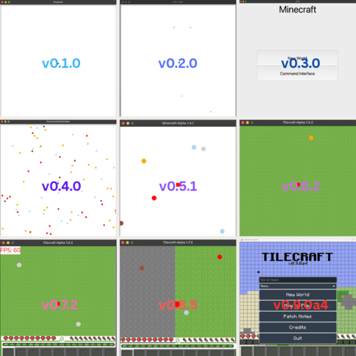

# Tilecraft 

Rewrite of my first project started in 2021, a 2D recreation of Minecraft.

## Installation

Install [uv](https://docs.astral.sh/uv/getting-started/installation/), then open a terminal in the cloned repository. The project requires Python 3.10 or newer; CI currently tests Python 3.10 and 3.13.

Checkout the code at the **latest alpha release**, and install dependencies:

```powershell
git checkout v0.9.0a4
uv sync --python 3.13 --no-dev
```

And then, run the game:

```
uv run --locked --no-dev python -m tilecraft
```

To run the latest *stable* release, check out the `v0.8.5` tag instead. Note that this release does not use `uv`, so dependencies have to be installed manually.

## Development

For a full development setup, check out the development branch and install the locked dependencies:

```powershell
git checkout develop
uv sync --locked --python 3.13
```

The default `dev` dependency group installs pytest, pytest-cov, and mypy alongside the game dependencies. uv creates `.venv` automatically; manual activation is not required.

Run the game from the repository root:

```powershell
uv run --locked python -m tilecraft
```

To run tests (including the configured coverage report):

```powershell
uv run --locked python -m pytest
```

To run type checking:

```powershell
uv run --locked mypy tilecraft
```

## Past Versions

This repository tracks versioning starting from `v0.8.0`, with a few minor versions missed. You can find the archived releases in the **Releases** tab on GitHub.

<figure>
  
  <figcaption align="center"><i>Iterations of the main screen throughout the project's history</i></figcaption>
</figure>
